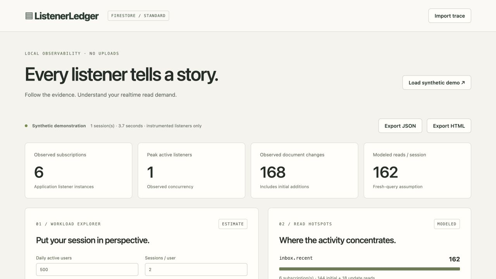

# ListenerLedger

**Understand what your Firestore listeners are costing you.**

ListenerLedger is a local-first Firestore Standard developer tool. Wrap realtime listeners, exercise your application, export metadata, and investigate subscription churn, broad queries, updates and lifecycle overlap. The same deterministic TypeScript engine powers a CLI, a static dashboard and CI budget assertions.

**Observed callbacks are not billed reads.** Reports separate SDK evidence, modeled document reads under explicit assumptions, and unknown overhead. No uploads, account connection, service credentials or paid services are needed.

## Local quick start

Requires Node.js 22 LTS, pnpm 10.20, and Java 21 for the Firestore Emulator.

```sh
corepack enable
pnpm install
pnpm build
pnpm test
pnpm dev:dashboard
# Open http://127.0.0.1:5173; choose Load synthetic demo or import JSON.
```

Dashboard sample data is explicitly synthetic. With no `?demo` parameter, the dashboard starts with a local import screen. Imported traces and reports remain on your machine. Assets work offline once served/cached locally; this is not an installable offline PWA.

Run the actual SDK demo in two terminals:

```sh
pnpm emulator
# Separate terminal, after emulator is ready:
pnpm demo:reset
pnpm dev:demo
# http://127.0.0.1:5174
```

Navigate Inbox → Conversation → Activity, modify data, compare normal cleanup with the explicitly inefficient lifecycle toggle, stop profiling and export the trace. Import it into the dashboard. SDK disable/enable controls record application actions; they do not claim to prove backend disconnects. The app is hardwired to `demo-listenerledger` on localhost:8080. The emulator config uses separate **emulator-only rules**; the default deployable rules deny all access. Never deploy `firestore.demo.rules`.

## Integrate with an application

Packages are prepared for distribution but have not been published to a package registry. Build workspace packages with `pnpm build`; create tarballs with `pnpm --filter @listenerledger/core pack` and `pnpm --filter @listenerledger/firestore-web pack` for local consumption, or use workspace dependencies. Install core alongside the wrapper from your local artifacts. Firebase 12 modular SDK is a peer dependency. The packages use pnpm workspaces; no npm commands are required.

```ts
import { collection, query, limit } from "firebase/firestore";
import { createListenerLedger } from "@listenerledger/firestore-web";

const ledger = createListenerLedger({
  enabled: import.meta.env.DEV, // disabled by default
  persistence: "memory", // declare your actual SDK configuration
  capture: "metadata-only",
});
ledger.setScreen("Inbox");
const unsubscribe = ledger.listen(
  query(collection(db, "messages"), limit(50)),
  { queryKey: "messages.recent", label: "Recent messages", screen: "Inbox" },
  (snapshot) => renderMessages(snapshot.docs),
  (error) => console.error(error),
);
// Normal application cleanup:
unsubscribe();
ledger.stop(); // stops recording, does not unsubscribe application listeners
const trace = ledger.exportTrace(); // JSON.stringify + local download
```

Queries and individual document references preserve generic snapshot inference. Observer callbacks and explicit SnapshotListenOptions are supported. See [instrumentation](docs/instrumentation.md) for React useEffect cleanup, recording controls, bounded retention and browser hints.

## CLI

```sh
pnpm cli validate fixtures/traces/efficient.json
pnpm cli analyze fixtures/traces/churn.json --dau 500 --sessions-per-user 2
pnpm cli analyze fixtures/traces/churn.json --format json --out /tmp/report.json
pnpm cli report /tmp/report.json --out /tmp/report.html
pnpm cli analyze fixtures/traces/churn.json --dau 500 --sessions-per-user 2 \
  --budget 50000 --fail-on-budget
node packages/cli/dist/index.js --help
```

The CLI package has a `listenerledger` bin when installed. JSON reports include sanitized trace evidence, assumptions, contributors, findings and unknown sources. Static HTML needs no scripts, CDN or backend. Exit codes: 0 success, 1 invalid input/command/IO failure, 2 a valid modeled budget assertion exceeded. Equality passes. An estimate exceeding a developer budget **does not establish an actual Firebase quota breach**.



## Read the report

- **Observed**: subscription instances, snapshot sizes, changes, cache and pending-write flags, screen and lifecycle activity.
- **Modeled**: first eligible server snapshot under a fresh-query assumption; later eligible query additions/modifications. Cache-first/server sequences are modeled once. Removal causes and subsequent document data changes remain unresolved.
- **Unknown**: SDK backend target sharing, reconnections, index-entry reads, Security Rules reads, acknowledgments and uninstrumented operations. Additional user assumptions do not make those sources measured.

Daily projection = (mean baseline/session × selected workload factor + declared replay/session + additional reads/session) × DAU × sessions/user. Light/baseline/heavy mean 0.5×/1×/2× observed demand. Daily read budget defaults to 50,000; all quota metadata is configurable through the core workload schema. Only reads are modeled. Pacific quota boundaries respect DST; Firebase resets occur around midnight, not necessarily at an exact computed instant.

The dashboard includes local file/drop import, query/screen filters, snapshot lifecycle ticks, screen/network markers, query and screen contributions, configurable traffic/reconnect scenarios, expandable evidence and JSON/HTML exports. Per-listener contributions and notes are available on timeline entries and in JSON. Intentional background listeners can be exempted from screen warnings. Findings flag evidence for investigation, not confirmed leaks or guaranteed savings.

## Architecture and accuracy

| Package                  | Responsibility                                                                             |
| ------------------------ | ------------------------------------------------------------------------------------------ |
| `packages/core`          | Zod trace validation, deterministic analysis, findings, workloads, terminal/HTML reporting |
| `packages/firestore-web` | Opt-in public Web SDK wrapper, metadata capture and local export                           |
| `packages/cli`           | Validation, analysis, report conversion and deterministic CI budgets                       |
| `apps/dashboard`         | React/Vite static local trace viewer                                                       |
| `apps/demo`              | Emulator-only multi-screen application using real instrumentation                          |

See [architecture](docs/architecture.md), [billing specification and official Firebase references](docs/billing-model.md), [privacy](docs/privacy.md), and [limitations](docs/limitations.md).

No exact per-listener billing counter exists in this tool. Client observations cannot establish production account totals. Emulator testing verifies instrumentation, not production billing. Standard and Enterprise have different billing models; Enterprise is unsupported. Production reconciliation, Cloud Billing/Monitoring, Admin SDK monitoring, team accounts and automatic telemetry are deliberately excluded.

## Development and verification

```sh
pnpm dev                  # dashboard
pnpm dev:dashboard
pnpm dev:demo             # emulator must already be running
pnpm emulator
pnpm demo:reset           # destructive only to local demo emulator data
pnpm test                 # pure engine and mocked lifecycle tests
pnpm test:integration     # starts/stops emulator; no Firebase credentials
pnpm exec playwright install chromium # first browser setup
pnpm test:e2e             # emulator + both Vite apps + browser workflow
pnpm lint                # Prettier formatting checks
pnpm typecheck
pnpm build
```

Build workspace libraries before initial dev/test runs; tests consuming package exports use dist. Following library changes, rebuild before integration/browser tests. Integration runs require free localhost ports 8080/9150; browser tests use 5173/5174. CI builds packages before checks and runs emulator/browser workflows without real project credentials. Unit tests distinguish documented billing-rule assumptions from tool-specific modeling and include DST, invalid input and deterministic budget checks.

Fixtures and expected baselines are documented in [fixtures/traces/README.md](fixtures/traces/README.md). Regenerate with `node --import tsx scripts/fixtures.ts`. No production benchmarks or billing-accuracy claims are made.

Firebase Hosting is configured to serve `apps/dashboard/dist`. Deployment is manual and requires a project you own: review configuration and run `firebase deploy --only hosting --project YOUR_PROJECT` after building. No deployment is performed by CI. Local demo rules and writes are not part of hosting.

MIT licensed. See [contributing](CONTRIBUTING.md).
