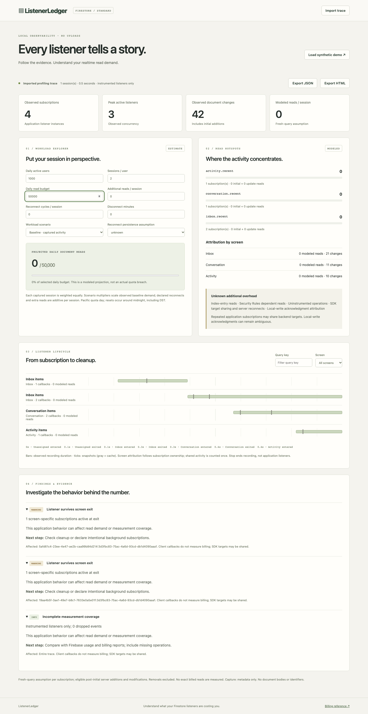
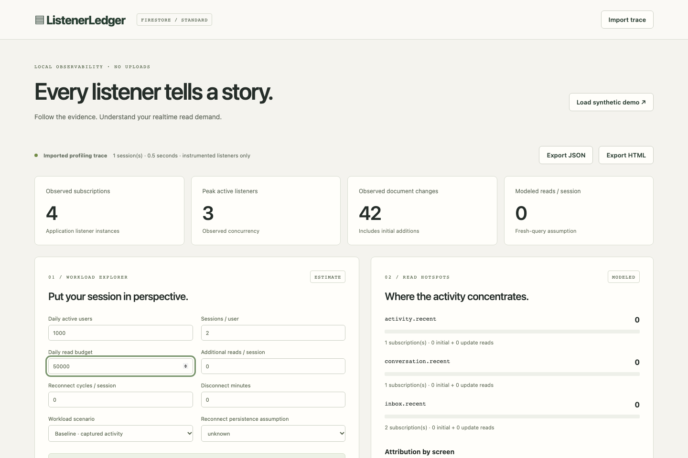
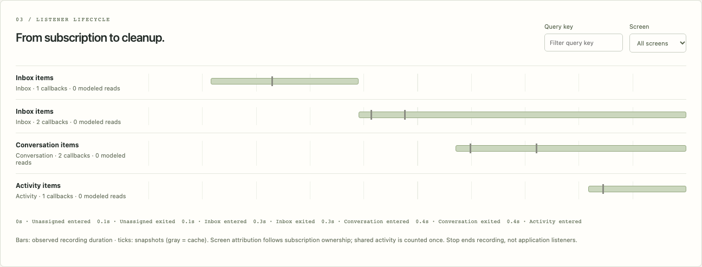
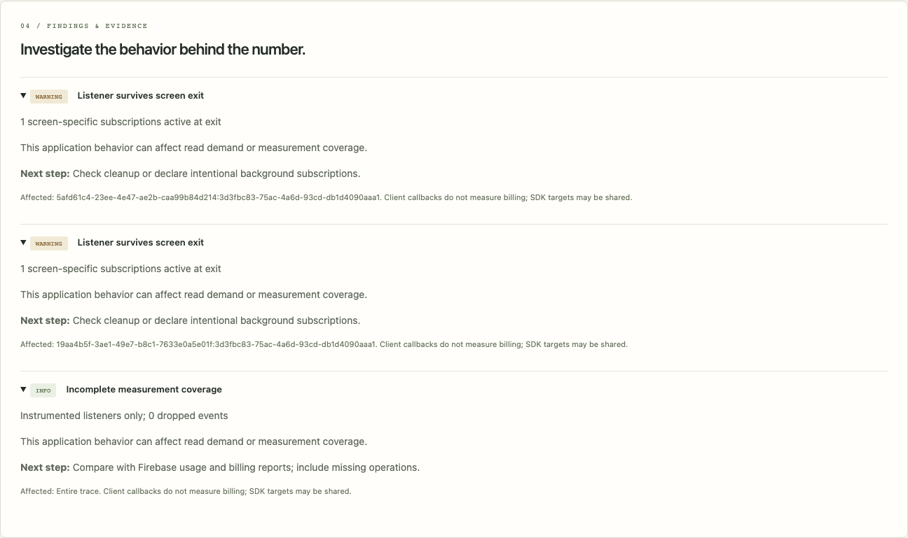
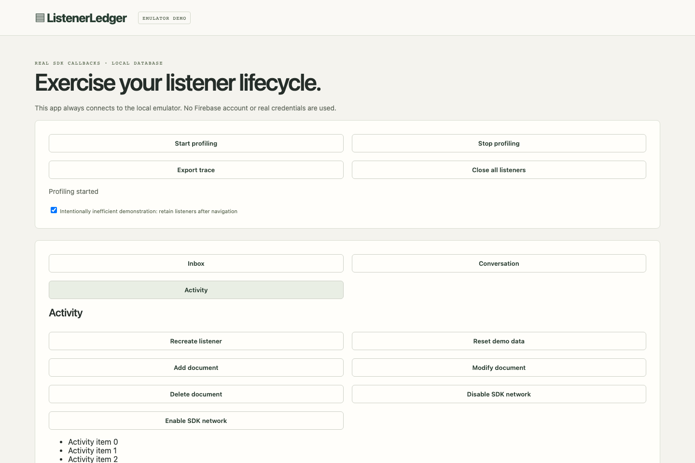
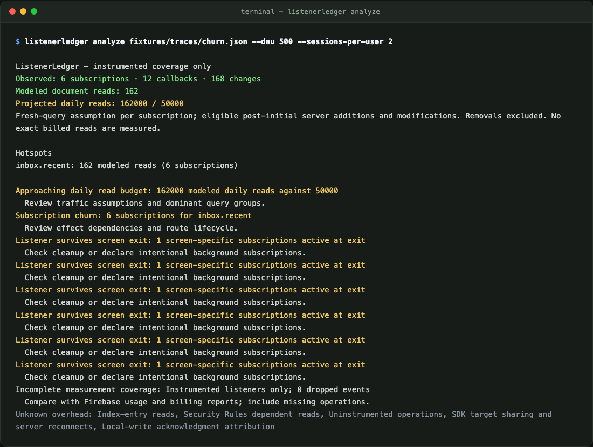

# ListenerLedger

**Understand what your Firestore listeners are costing you.**

[](LICENSE)
[](tsconfig.base.json)
[](package.json)
[](https://firebase.google.com/docs/firestore)

ListenerLedger is a local-first Firestore Standard developer tool. Wrap realtime listeners, exercise your application, export metadata, and investigate subscription churn, broad queries, updates, and lifecycle overlap. The same deterministic TypeScript engine powers a CLI, an offline-capable static dashboard, and deterministic CI budget assertions.



> **Observed callbacks are not billed reads.** ListenerLedger strictly separates SDK evidence, modeled document reads under explicit fresh-query assumptions, and unknown backend overhead. No uploads, account connections, service credentials, or paid services are required.

---

## The Problem It Solves

Firestore's billing model charges for document reads, not client callback invocations. In complex client applications:

1. **Subscription Churn:** Subtle dependency changes in React `useEffect` or route transitions repeatedly mount and unmount identical listeners, triggering repeated initial document query reads.
2. **Uncollected Listeners:** Listeners that survive screen transitions keep accumulating document modifications and background reads without user awareness.
3. **Broad Initial Queries:** Missing limits or overly permissive queries pull hundreds of documents on initial snapshot where a narrower window would suffice.
4. **Ambiguous Local Updates:** Optimistic local writes, metadata-only flag changes, and cached snapshots fire client callbacks that do _not_ generate billed server reads.

ListenerLedger instruments the Firebase Web SDK to record lifecycle events with zero payload inspection, models realistic billing reads, and surfaces actionable diagnostic findings before code reaches production.

---

## Key Features

- **Metadata-Only Capture:** Zero payload capture. Document bodies, fields, and IDs are never inspected or retained; only collection keys, snapshot sizes, change counts, and latency markers are recorded.
- **Deterministic Read Engine:** Models first eligible server snapshots under fresh-query assumptions, counts post-initial additions and modifications, and isolates ambiguous removals and cache callbacks.
- **Local Interactive Dashboard:** A standalone React/Vite dashboard featuring interactive workload forecasting, query hotspots, lifecycle timeline rails, and diagnostic findings.
- **Deterministic CLI & CI Budgets:** Validate trace schemas, analyze sessions with custom DAU/traffic assumptions, generate self-contained HTML reports, and assert read budgets in CI pipelines (`--fail-on-budget`).
- **Complete Emulator Sandbox:** Includes an emulator-backed demo app that lets developers simulate normal cleanup vs. intentionally inefficient subscription retention and test disconnect resilience.
- **100% Offline & Private:** Operates entirely on your local machine with no external network calls, authentication, telemetry, or cloud tracking.

---

## Visual Showcase & Feature Gallery

### Dashboard & Workload Explorer

Forecast daily document reads by scaling observed session demand across customizable Daily Active Users (DAU), sessions per user, scenario multipliers, and reconnect assumptions.



---

### Listener Lifecycle Timeline

Inspect the duration of each subscription instance, identify overlapping listeners, view server vs. cache snapshot ticks, and pinpoint listeners that leak across screen exit boundaries.



---

### Automated Diagnostic Findings

Automated heuristic checks detect subscription churn, high-update query groups, oversized initial snapshots, and read budget saturation with root-cause explanations and concrete recommendations.



---

### Interactive Emulator Demo App

Test the SDK wrapper against a live Firestore emulator. Exercise multi-screen navigation (Inbox &rarr; Conversation &rarr; Activity), trigger document additions, modifications, and deletions, simulate network toggles, and toggle intentionally inefficient listener retention.



---

### CLI Terminal Analysis

Run automated checks against exported trace files in terminal environments and CI jobs.



---

## Quick Start

### Prerequisites

- **Node.js**: `>= 22 LTS`
- **pnpm**: `10.20` (or compatible pnpm workspace runner)
- **Java**: `21+` (required by the Firebase Firestore Emulator)

### 1. Install & Build

```sh
corepack enable
pnpm install
pnpm build
pnpm test
```

### 2. Launch the Static Dashboard

```sh
pnpm dev:dashboard
# Open http://127.0.0.1:5173
```

Click **Load synthetic demo** or drop an exported JSON trace into the browser. The dashboard runs entirely locally.

### 3. Run the Interactive Emulator Demo

In two terminal windows:

```sh
# Terminal 1: Start Firestore Emulator on localhost:8080
pnpm emulator

# Terminal 2: Seed local emulator data and launch demo application
pnpm demo:reset
pnpm dev:demo
# Open http://127.0.0.1:5174
```

1. Navigate between **Inbox** &rarr; **Conversation** &rarr; **Activity**.
2. Click **Add document** or **Modify document** to observe live snapshot updates.
3. Toggle **Intentionally inefficient demonstration: retain listeners after navigation** to test memory and read leaks.
4. Click **Stop profiling** &rarr; **Export trace** to download `session.json`.
5. Import `session.json` directly into the Dashboard at `http://127.0.0.1:5173`.

---

## Application Integration

Packages are structured as pnpm workspace packages ready for local consumption or packaging (`pnpm --filter @listenerledger/core pack` and `pnpm --filter @listenerledger/firestore-web pack`).

```ts
import { collection, query, limit } from "firebase/firestore";
import { createListenerLedger } from "@listenerledger/firestore-web";

// 1. Initialize the ledger (typically enabled only in development)
const ledger = createListenerLedger({
  enabled: import.meta.env.DEV,
  persistence: "memory", // "memory" | "persistent" | "unknown"
  capture: "metadata-only",
});

// 2. Set screen context for lifecycle attribution
ledger.setScreen("Inbox");

// 3. Wrap standard Firestore query or document listeners
const unsubscribe = ledger.listen(
  query(collection(db, "messages"), limit(50)),
  {
    queryKey: "messages.recent",
    label: "Recent messages",
    screen: "Inbox",
    background: false, // set true for intentional background listeners
  },
  (snapshot) => {
    renderMessages(snapshot.docs);
  },
  (error) => {
    console.error("Listener error:", error);
  },
);

// 4. Clean up listener on component unmount
unsubscribe();

// 5. Export trace metadata as JSON
ledger.stop();
const trace = ledger.exportTrace();
```

---

## CLI Usage

The `@listenerledger/cli` package provides a standalone binary and scripting interface:

```sh
# Validate a v1 trace file against the Zod schema
pnpm cli validate fixtures/traces/efficient.json

# Analyze trace with custom traffic parameters
pnpm cli analyze fixtures/traces/churn.json --dau 500 --sessions-per-user 2

# Output machine-readable JSON report
pnpm cli analyze fixtures/traces/churn.json --format json --out /tmp/report.json

# Render a self-contained standalone HTML report
pnpm cli report /tmp/report.json --out /tmp/report.html

# Enforce a CI budget check (exits with code 2 if modeled reads exceed budget)
pnpm cli analyze fixtures/traces/churn.json --dau 500 --sessions-per-user 2 \
  --budget 50000 --fail-on-budget
```

### CLI Exit Codes

- `0`: Success (analysis complete, budget respected).
- `1`: Invalid input arguments, schema validation failure, or file I/O error.
- `2`: Modeled daily read projection exceeded the configured `--budget` threshold when `--fail-on-budget` is set.

---

## Understanding the Billing Model

ListenerLedger models document reads based on documented Firestore Standard billing specifications:

| Metric Category       | What Is Counted                                                                                                                  | Important Caveats                                                                                               |
| :-------------------- | :------------------------------------------------------------------------------------------------------------------------------- | :-------------------------------------------------------------------------------------------------------------- |
| **Observed Evidence** | Subscriptions, snapshot callback counts, sizes, additions, modifications, removals, cache flags, and screen navigation.          | Callbacks are client events, not billed transactions.                                                           |
| **Modeled Reads**     | Initial server snapshot (fresh-query assumption), subsequent document additions and modifications. Empty query = 1 read minimum. | Cache-to-server transitions counted once. Removals are isolated (cannot infer server trigger without payloads). |
| **Unknown Overhead**  | Index-entry reads, Security Rules dependent reads, SDK target sharing, backend reconnects, uninstrumented queries.               | Cannot be measured from client-side callbacks alone.                                                            |

### Daily Projection Formula

$$\text{Daily Projected Reads} = \left(\frac{\text{Modeled Reads}}{\text{Sessions}} \times \text{Workload Factor} + \text{Reconnect Reads} + \text{Additional Reads}\right) \times \text{DAU} \times \frac{\text{Sessions}}{\text{User}}$$

- **Workload Factor**: `0.5×` (Light), `1.0×` (Baseline), `2.0×` (Heavy).
- **Daily Read Budget**: Defaults to 50,000 (standard Firebase Spark free tier limit).
- **Reset Boundary**: Calculated against Pacific time (midnight America/Los_Angeles), accounting for daylight saving transitions.

---

## Architecture

| Package / Directory                                | Responsibility                                                                                                          | Tech Stack                      |
| :------------------------------------------------- | :---------------------------------------------------------------------------------------------------------------------- | :------------------------------ |
| [`packages/core`](packages/core)                   | Zod schema validation, deterministic trace analysis, findings engine, workload projections, terminal and HTML reporting | TypeScript, Zod                 |
| [`packages/firestore-web`](packages/firestore-web) | Public Web SDK wrapper, metadata-only listener interception, browser connectivity hints, local export                   | TypeScript, Firebase Web SDK 12 |
| [`packages/cli`](packages/cli)                     | CLI commands (`validate`, `analyze`, `report`), CI budget verification                                                  | TypeScript, Commander           |
| [`apps/dashboard`](apps/dashboard)                 | Static local trace explorer, workload simulator, timeline rails, findings inspector                                     | React 19, Vite                  |
| [`apps/demo`](apps/demo)                           | Multi-screen demo application connected to local Firestore emulator                                                     | React 19, Vite, Firebase SDK    |
| [`tests/`](tests)                                  | Integration test suite against Firestore emulator and Playwright end-to-end browser workflows                           | Vitest, Playwright              |
| [`fixtures/traces`](fixtures/traces)               | Documented synthetic trace scenarios (`churn`, `efficient`, `large-query`, `high-updates`, `reconnect`, `cache-heavy`)  | JSON                            |

For deeper technical documentation, review:

- [Architecture & Design Details](docs/architecture.md)
- [Firestore Billing Model Reference](docs/billing-model.md)
- [SDK Instrumentation Guide](docs/instrumentation.md)
- [Model Limitations & Boundaries](docs/limitations.md)
- [Privacy & Data Handling](docs/privacy.md)

---

## Development & Verification

```sh
# Build all workspace packages and apps
pnpm build

# Run unit tests across packages (Vitest)
pnpm test

# Run Firestore emulator integration tests
pnpm test:integration

# Run full end-to-end browser workflows and screenshot verification (Playwright)
pnpm test:e2e

# Run TypeScript typechecks
pnpm typecheck

# Run Prettier code style checks
pnpm lint
```

---

## Contributing

Contributions are welcome! Please review [CONTRIBUTING.md](CONTRIBUTING.md) and [CODE_OF_CONDUCT.md](CODE_OF_CONDUCT.md) before submitting pull requests.

---

## License

Distributed under the MIT License. See [LICENSE](LICENSE) for details.
